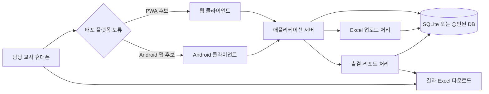

# 야자·심자 관리 시스템

## 애플리케이션 개요

고등학교 야간자율학습(야자)·심야자율학습(심자) 운영을 위한 교사용 관리 애플리케이션입니다.

선생님들이 작성한 Excel 파일을 업로드하면 앱이 날짜·야자/심자 구분별 대상자를 만들고, 담당 교사가 휴대폰에서 참석·입실·퇴실·불참 여부를 기록합니다. 기록이 끝나면 출결 결과가 포함된 Excel 파일을 다운로드하고 주간·월간 리포트를 확인합니다.

- 사용자: 담당 교사 1명
- 대상: 학생 20~40명
- 학생 로그인·신청 기능: 없음
- 핵심 입력: `학번`, `이름`, `반`, `날짜`, `구분`
- 핵심 흐름: Excel 업로드 → 출결 체크 → 결과 Excel 다운로드 → 리포트 확인
- 최종 배포 플랫폼: PWA 또는 Android 앱 중 보류
- 운영망: 학교 내부망 상시 서버 우선 검토
- 목적: 학교 공식 출결을 대체하지 않는 야자·심자 운영 보조
- 재업로드: 기존 출결을 삭제·덮어쓰지 않고 신규 유효 행만 반영
- 출결 마감: 교사가 최종 상태를 확정하며 미체크는 자동 결석 처리하지 않음

## 전체 아키텍처 다이어그램



핵심 업무 데이터는 플랫폼과 독립적으로 관리합니다. PWA를 선택하든 Android 앱을 선택하든 동일한 애플리케이션 서버에 연결하며, Excel 실시간 양방향 동기화는 MVP에 포함하지 않습니다.

## 시작하기

현재 저장소는 기획 문서 중심 단계입니다. 구현을 시작할 때 다음 문서를 먼저 확인합니다.

1. [IDEATION.md](./docs/IDEATION.md): 제품 배경, 목표, 범위, 운영 원칙
2. [ARCHITECTURE.md](./docs/ARCHITECTURE.md): 권장 개발 언어·스택·운영 구조
3. [PRD.md](./docs/PRD.md): 기능 요구사항, 인수조건, 테스트 시나리오

구현은 최신 PRD의 범위와 인수조건을 확인한 뒤 별도 합의 후 시작합니다.

## 사전 개발 환경 요구사항 (Prerequisites)

구현 시작 시 다음 환경을 준비합니다.

- macOS, Windows 또는 Linux
- Node.js 22 LTS
- pnpm
- Git
- Docker Desktop 및 Docker Compose
- Android 앱을 선택하는 경우 Android Studio와 Android SDK
- Excel 파일을 확인·작성할 수 있는 프로그램
- 학교 내부망 상시 서버 또는 학교가 승인한 호스팅 환경

권장 개발 스택은 TypeScript 5.x(strict), Next.js 15+(App Router), Prisma, SQLite, Tailwind CSS, shadcn/ui, zod, xlsx, Vitest, Playwright입니다. 최종 PWA·Android 배포 결정은 아직 보류되어 있습니다.

## 애플리케이션 실행하기 (로컬)

구현이 시작된 뒤의 기준 실행 절차입니다.

```bash
pnpm install
pnpm prisma migrate dev
pnpm dev
```

브라우저에서 `http://localhost:3000`에 접속합니다.

로컬 실행 시 확인할 업무 흐름:

1. 교사 패스코드로 로그인
2. `학번, 이름, 반, 날짜, 구분` 열이 있는 Excel 업로드
3. 날짜·슬롯별 출결 대상자 확인
4. 참석·입실·퇴실·불참 및 불참 사유 기록
5. 결과 Excel 다운로드
6. 주간·월간 리포트 확인

실제 학생 정보를 사용하기 전에는 학교의 개인정보·운영 승인과 배포 환경을 확인해야 합니다.

## 애플리케이션 배포하기 (Azure) - 추후 작성

Azure 배포 절차는 최종 플랫폼과 학교의 개인정보·보안 정책이 확정된 뒤 작성합니다.

추후 결정할 항목:

- Azure App Service, Container Apps 또는 학교 내부 서버 중 운영 위치
- SQLite 유지 또는 Azure Database for PostgreSQL 이전
- 학교 승인된 리전과 개인정보 국외 이전 검토
- HTTPS, 네트워크 접근 제한, 비밀값 관리
- 백업·복구 책임자와 보존·파기 정책
- PWA 또는 Android 앱의 최종 배포 방식

## 애플리케이션 테스트하기

테스트 범위는 [PRD.md](./docs/PRD.md)의 인수조건과 테스트 시나리오를 기준으로 합니다.

### 단위 테스트

- Excel 행 검증과 날짜·슬롯 변환
- 중복 대상자 판정
- 입실 시각과 지각 기준 판정
- 퇴실 시각과 조퇴 판정
- 참석률·지각·결석·미체크 집계
- KST 날짜 처리

```bash
pnpm test:unit
```

### 통합 테스트

- Excel 업로드에서 출결 대상자 생성까지
- 출결 저장과 감사 로그 기록
- 결과 Excel 생성
- 캘린더 예외일 처리
- 데이터베이스 저장·조회 흐름

```bash
pnpm test:integration
```

### E2E 테스트

- 교사 로그인
- Excel 30행 업로드
- 날짜·슬롯별 대상자 생성 확인
- 참석·입실·퇴실·불참 및 사유 입력
- 결과 Excel 다운로드
- 리포트 수치 확인

```bash
pnpm test:e2e
```

### 전체 테스트

```bash
pnpm test
```

## 개인정보 및 작업 원칙

- 학생 이름·학번·반·출결 등 필요한 최소 정보만 사용합니다.
- 보호자 연락처, 건강정보, 증빙자료는 MVP에서 저장하지 않습니다.
- 불참 사유는 교사가 작성할 수 있지만 질병명·건강정보·가정사 등 상세 개인정보는 입력하지 않습니다.
- 학교 공식 출결을 대체하지 않는 보조 기록으로 운영합니다.
- 플랫폼 결정 전 PWA 또는 Android 배포를 확정하지 않습니다.
- 기획 검토 단계에서는 코드·테스트·의존성·배포 설정을 임의로 변경하지 않습니다.
